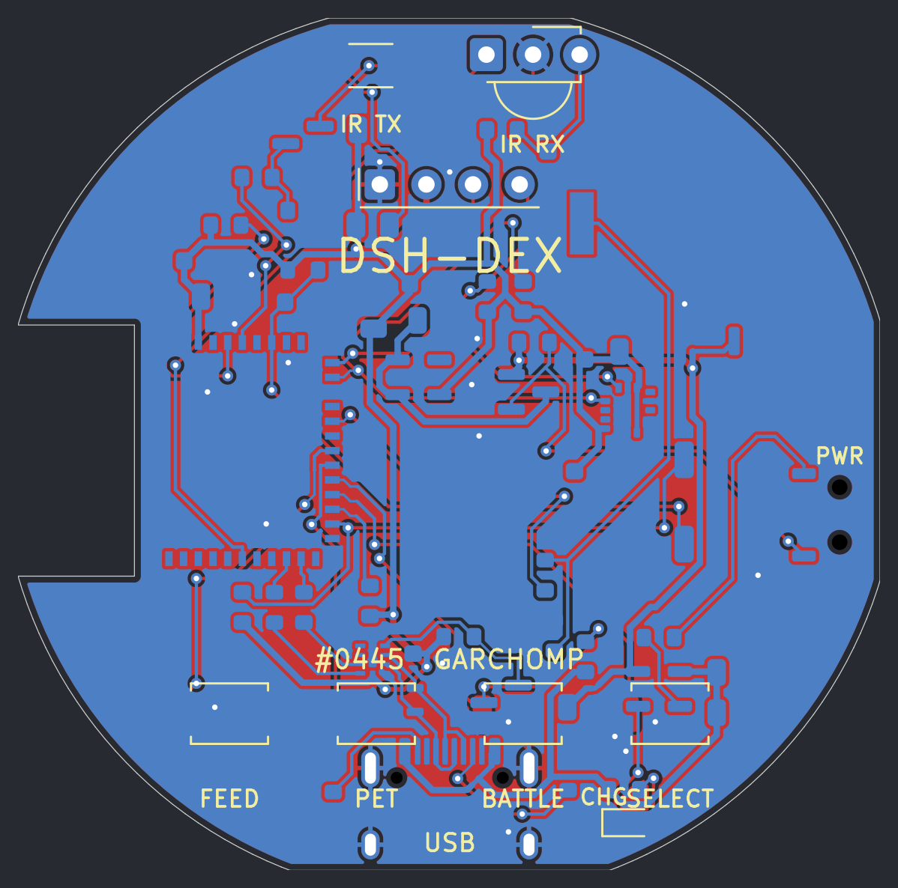

# DSH-DEX
A portable pokemon themed tomogatchi. Made with :heart: for Dhruv 

### *still in assembly stage*

so basically DSH-DEX is a little pokemon pet on a keychain. it's a custom ESP32-C3 pcb with a tiny black and white OLED inside a sliding pokeball.

## why i made it

i made it for Dhruv. i wanted a pokemon pet you could actually carry around and battle another one with, so i put it in a pokeball that slides open.

## how to use it

1. flash the pokemon you want, then use the switch on the side to turn it on.
2. slide the red half **up** to see the screen and the white half **down** to get to the buttons.
3. press **FEED** to give it a berry, **PET** to make it happy, or **SELECT** to see its stats.
4. tap **BATTLE** on both units and point their IR windows at each other. shake during the 3-second countdown to boost your attack. if youre playing alone, hold **BATTLE** for practice.
5. charge it over USB-C with the power switch off.

## build files

- **pcb** — [KiCad files](hardware/kicad/), [Gerbers](hardware/manufacturing/DSH-DEX-Gerbers.zip), and [assembly files](hardware/manufacturing/Assembly/). im getting mine assembled. the [order instructions](hardware/manufacturing/README.md) have the settings and what to ask for.
- **bom** — [the parts list with links and prices](hardware/DSH-DEX-BOM.csv). the prices are estimates. the battery still needs a supplier quote.
- **case** — [seven separate STLs](enclosure/Print-Ready/DSH-DEX-Print-STLs.zip) and [assembly instructions](enclosure/Print-Ready/README.md). send the seven files to the print shop at 100% scale in mm, then put the pcb, battery and magnets in yourself. the [separated Fusion and STEP files](enclosure/Print-Ready/) are there too.
- **firmware** — flash whichever pokemon you want: [Garchomp #0445](firmware/Garchomp/), [Giratina #0487](firmware/Giratina/), or [Metagross #0376](firmware/Metagross/). use the first-flash file for a blank board and the app file if youre switching pokemon and want to keep your saves. [flash instructions](firmware/README.md) / [source](firmware/dsh_dex/)
- **sprites** — [72 x 64 monochrome pngs](assets/sprites/) for all three.

## screenshots

### full 3d assembly

the red half slides up and the white half slides down. you can see the pcb, OLED and buttons in the middle.

### pcb

[3d view of the populated pcb](assets/renders/DSH-DEX-THT-preview.png)

### schematic

## restore the cad files

if you want the original assembled model or the pcb in 3d, download the repo and run `sh restore-cad.sh` from the repo folder. it'll put the Fusion assembly in `enclosure/`, the board STEP in `hardware/`, and the KiCad 3d models in `hardware/kicad/3dmodels/`.

## where its at rn

Nothing is built yet, once the buildstage is finished, ill add all the steps with actual photos, from the physical project.

# AI USAGE
This section covers how i used ai, so i mainly js used ai for bug fixing (35%~ of code) <--- ik that seems like a lot but im a shitty coder so there was a shit ton of bugs, i also used ai for uploading files since theres no upload limit for ai agents, and i also used it to make the assembly instruction better and more formal from the my current tone it is easier to understand.
