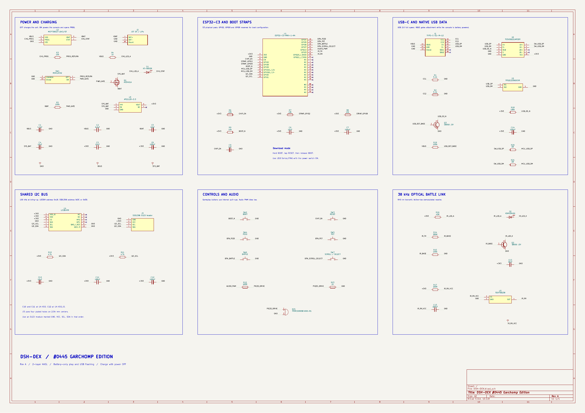

# DSH-DEX

Dhruv loves Pokémon, so I made him a Poké Ball virtual pet for his birthday back in September. It's small enough to go on his keychain. I'm still putting the first one together, so the pictures below are from CAD. I'll add photos when it's built.

## playing it

Turn it on with the side switch. Slide the red half up to see the OLED and the white half down to get to the buttons. **Feed** gives it a berry, **Pet** makes it happy, and **Select** shows its stats.

If your friend has one too, point the two units at each other and tap **Battle** on both. You get three seconds to shake it and power up your attack. Hold **Battle** for solo practice. Flip the switch off to charge over USB-C.

## pics

**Case open in Fusion**

**PCB** ([populated board in 3D](assets/renders/DSH-DEX-THT-preview.png))

**Schematic** (click to zoom)

## making one

- **Board** · [KiCad files](hardware/kicad/), [Gerbers](hardware/manufacturing/DSH-DEX-Gerbers.zip), [BOM and placement files for the assembler](hardware/manufacturing/Assembly/), and [how to order it](hardware/manufacturing/README.md).
- **Parts** · [BOM with links and prices](hardware/DSH-DEX-BOM.csv). Prices are estimates. I still need a quote for the battery.
- **Case** · [Seven STLs for the print shop](enclosure/Print-Ready/DSH-DEX-Print-STLs.zip). Send them at 100% scale in mm, then [put it together](enclosure/Print-Ready/README.md). The [Fusion and STEP print layouts](enclosure/Print-Ready/) are there too.
- **Firmware** · Pick [Garchomp #0445](firmware/Garchomp/), [Giratina #0487](firmware/Giratina/), or [Metagross #0376](firmware/Metagross/). Use the first-flash file on a blank board and the app file when switching Pokémon so you keep your saves. [Flash instructions](firmware/README.md) · [Arduino code](firmware/dsh_dex/) · [sprites](assets/sprites/)

Run `sh restore-cad.sh` from the repo folder to unpack the assembled Fusion model, PCB STEP, and KiCad 3D models.

# AI USAGE
This section covers how i used ai, so i mainly js used ai for bug fixing (35%~ of code) <--- ik that seems like a lot but im a shitty coder so there was a shit ton of bugs, i also used ai for uploading files since theres no upload limit for ai agents, and i also used it to make the assembly instruction better and more formal from the my current tone it is easier to understand.
