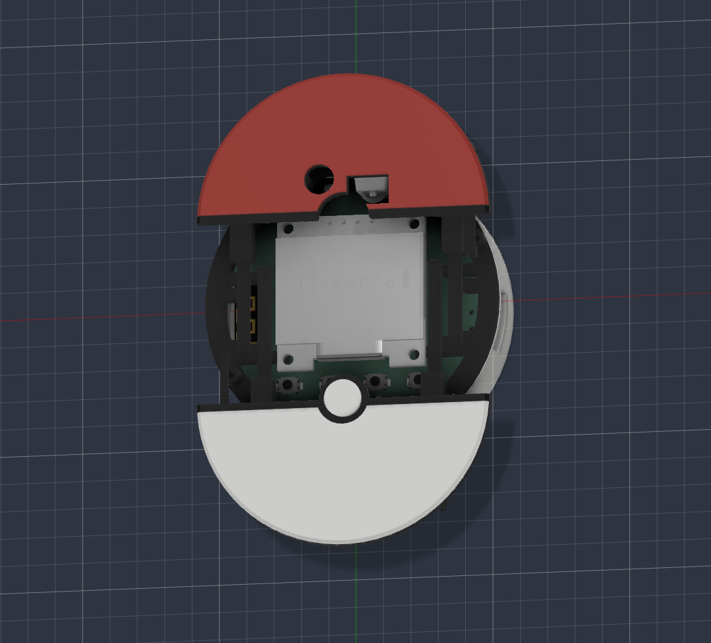

# DSH-DEX
A portable pokemon themed tomogatchi. Made with :heart: for Dhruv 
### *still in assembly stage*
DSH-DEX is an ESP32-C3 virtual pet in a sliding Poké Ball keychain. It uses a 128 × 64 monochrome OLED, four gameplay buttons, motion input, a piezo buzzer, and IR battles between units.

| What you want to do | Where to start |
| --- | --- |
| Order the assembled PCB | [Manufacturing instructions](hardware/manufacturing/README.md), [Gerber ZIP](hardware/manufacturing/DSH-DEX-Gerbers.zip), [assembly BOM and placement files](hardware/manufacturing/Assembly/) |
| Budget and source the whole build | [Linked BOM with cost estimates](hardware/DSH-DEX-BOM.csv) |
| Edit the circuit or board | [KiCad project](hardware/kicad/DSH-DEX.kicad_pro), [schematic](hardware/kicad/DSH-DEX.kicad_sch), [PCB](hardware/kicad/DSH-DEX.kicad_pcb) |
| Print the split enclosure | [Print-shop ZIP](enclosure/DSH-DEX-Split-Print-Shop.zip), [individual STLs](enclosure/Print-STLs/), [assembly notes](enclosure/Assembly-notes.md) |
| Open the Fusion model or view the PCB in 3D | [Restore the CAD files](#restore-the-cad-files) |
| Flash a Pokémon | [Firmware instructions](firmware/README.md), [Garchomp #0445](firmware/Garchomp/), [Giratina #0487](firmware/Giratina/), [Metagross #0376](firmware/Metagross/), [Arduino source](firmware/dsh_dex/) |
| Try the game on a laptop | [Offline browser preview](preview/DSH-DEX-Preview.html). Download the HTML and open it locally. It runs the earlier Garchomp UI firmware. |
| Download the OLED art | [72 × 64 monochrome sprites](assets/sprites/) |

## Prototype status

Nothing is built yet, once the buildstage is finished, ill add all the steps with actual photos, from the physical project.

# AI USAGE
This section covers how i used ai, so i mainly js used ai for bug fixing (35%~ of code) <--- ik that seems like a lot but im a shitty coder so there was a shit ton of bugs, i also used ai for uploading files since theres no upload limit for ai agents, and i also used it to make the assembly instruction better and more formal from the my current tone it is easier to understand.
